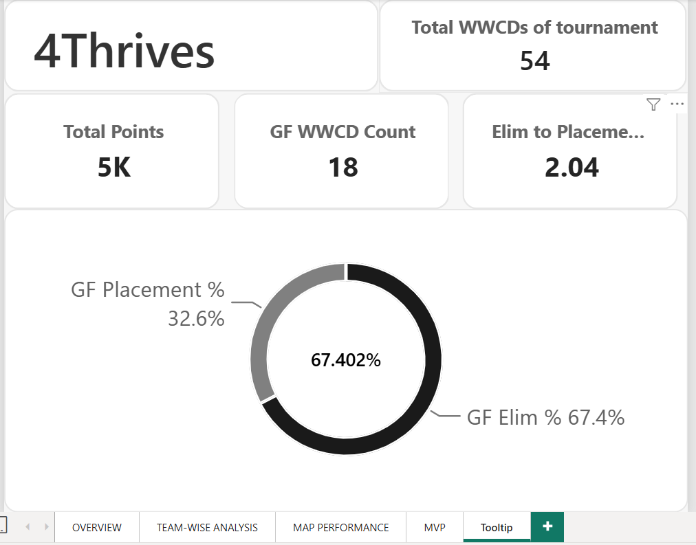

# PMWC 2026 Esports Performance Dashboard
### ACCESS THE ACTUAL PROJECT FILE : https://drive.google.com/file/d/13CQUK3we5ThMdYXPKlBJt5BgO5bW1KCK/view?usp=sharing

An interactive, multi-page Power BI analytics dashboard analyzing team performances, map trends, benchmark metrics, and Grand Finals MVPs for the **PUBG Mobile World Cup (PMWC) 2026**.

---

## Project Purpose

* **Bridging Passions:** To bridge my skills in data analytics with my deep passion for esports (BGMI / PUBG).
* **Storytelling with Numbers:** To make numbers speak so it becomes easier for people to understand insights at a glance instead of staring at raw spreadsheets. I wanted to turn tournament data into a comprehensive recap so no one misses out on key stats and deep analysis.
* **Value for Organizations:** Useful for viewers and esports organizations alike, helping them spot mistakes through visual match breakdowns to improve future performances.
* **The Indian Team Journey:** A major personal motivation behind building this project was to help Indian organizations analyze what went wrong in the finals. Seeing GodLike qualify #3 in Group B with 105 points (8.75 avg) and Orangutan score 91 points as #2 in Group A showed that our Indian teams completely dominated their groups—raising the burning question of what went wrong when it mattered most.
* **PMGC Preparation:** Having followed all Indian and international tournaments closely, and with PMGC starting in November–December with an Indian slot secured, my goal is for teams to look back at these analytics, learn from previous Indian team mistakes, and prep effectively.

---

## Project Overview

The project aims to highlight every specific team, match, and map to show how teams performed at one of the most important tournaments: PMWC 2026.

* **1. Tournament Overview:** Displays champions, MVP, match-to-match performance trends, and dynamic slicers.
* **2. Team-Wise Analysis:** A deep-dive drill-through allowing users to walk through stages to uncover which rounds gave a team a lead or tore them down. Includes direct comparisons with top teams (S2G, Aurora, NS RedForce) alongside Indian teams (GodLike and Orangutan).
* **3. Map Performance:** Highlights where teams need to improve—whether in placement, kills, or both. For example, Rondo is a crucial map with a recall system, yet it was S2G's lowest-scoring map (11 points across 3 matches, ranking 14th on Rondo). Despite this, they won the championship because they played unreal on Erangel (9 matches, 108 points, rank 1 in finals). This is a prime example of how we analyze a team's strategy.
* **4. Grand Final MVPs:** Spotlights the players who made their teams shine in the finals. It also proves a vital lesson: individual kills don't automatically win championships. There are 0 players from S2G on the MVP list, whereas NS RedForce has 2 players (HYUNBIN & TIZ1) yet finished 2nd. An MVP or standout individual doesn't lift the trophy alone—teamwork makes the dream work, as S2G proved. On the flip side, a player like Spower from GodLike made the MVP list even though the team finished 14th. This shows Spower did his job individually, but the team overall needs better communication and structural improvement.
* *Note:* The MVP page also highlights specific player strengths (e.g., Spower's high utility and grenade efficiency, backed directly by the data stats).

---

## Tools & Technologies
* **Power BI Desktop**
* **DAX (Data Analysis Expressions)**
* **Power Query (Data Cleaning & Transformation)**
* **Excel / CSV Datasets**

---

